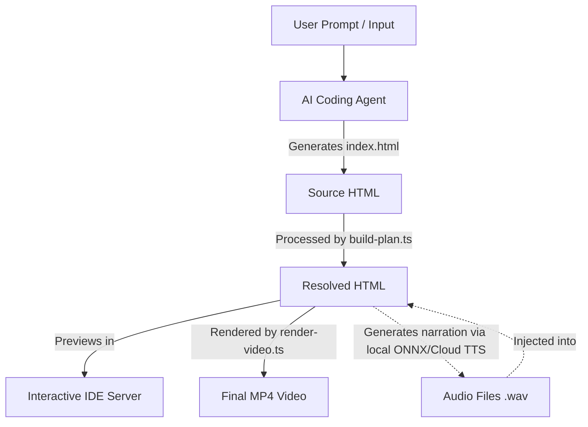

# MyLecture IDE - Agent Navigation & Architecture Guide

Welcome, Agent! This guide is designed to help you quickly understand the repository structure, data flows, and build pipelines of the MyLecture IDE.

---

## 1. High-Level Architecture Flow



---

## 2. Directory Structure & Key Files

* **`packages/`** - Monorepo workspaces
  * **`packages/lecture-agent/`** - The AI Coding Agent
    * `src/coding_agent.ts` - Main entry point for CLI and IDE chat sessions.
    * `src/llm_model.ts` - LLM clients for Gemini and OpenAI (fallback mode).
    * `src/validate_contract.cjs` - Fast VM & Playwright validator for checking the HTML contract.
    * `system_prompt.md` - Core instructions defining how the agent writes HTML/visuals/scripts.
    * `workspace/` - Workspace root for file operations when the agent runs.
  * **`packages/lecture-viewer/`** - Frontend playback viewer
    * `src/player/index.ts` - Core playback engine that controls scrubbing, timelines, and iframe messaging.
* **`models/`** - Model assets directory
  * `models/kokoro-onnx/` - Local ONNX weights, voices, and tokenizer JSON for the Kokoro TTS engine.
* **`src/`** - Main pipeline scripts & CLIs
  * `src/ide-server.ts` - Local HTTP server for the IDE. Serves the viewer UI, file browser, and proxies prompts to the coding agent.
  * `src/build-plan.ts` - Reads source plans (`window.__VIDEO_PLAN__`), generates missing audio clips, measures duration via `ffprobe`, and outputs timeline-ready resolved HTML.
  * `src/render-video.ts` - Uses Playwright in headless mode to capture frames deterministically, mixes audio cues using ffmpeg, and muxes them into a final MP4.
  * `src/sync-versions.ts` - Version synchronizer script.
* **`tests/`** - Fixtures and validation tests
  * `tests/fixtures/` - Smoke test suites for Visual 3D animations, rendering, and contract synchronization.
* **`outputs/`** - Generated outputs (ignored by git, located inside packages/workspace)

---

## 3. Core Workflows & Commands

### A. Setup & Environment
Ensure you run `npm install` at the root directory to hoist all monorepo dependencies.
Your root `.env` must contain:
```env
GOOGLE_API_KEY="your_gemini_key"
OPENAI_API_KEY="your_openai_key"
AGENT_MODEL="gemini-3.5-flash"  # Required for the Coding Agent
```

### B. Spawning the IDE
```bash
npm run ide
```
Runs the IDE on `http://127.0.0.1:4307/`. The IDE server compiles the viewer, synchronizes versions, and communicates with the agent script using standard input (`stdin`) to avoid Windows CLI quoting issues.

### C. Resolution Phase (Source HTML -> Resolved HTML)
* **Goal**: Measure narration text lengths and link real audio.
* **Triggered by**: `build-plan.ts` (automatically called by `render-video.ts` or run manually via `npm run build:plan`).
* **Audio Gen**: Calls Python `src/utils/tts.py` to create WAV files. Uses the local Kokoro ONNX model at `models/kokoro-onnx/` by default.

### D. Rendering Phase (Resolved HTML -> MP4)
* **Goal**: Capture frame-by-frame screenshots and mux video.
* **Triggered by**: `render-video.ts` (run manually via `npm run render:video`).
* **Frame Capturing**: Spawns multiple parallel Playwright pages to call `window.renderAt(time)` deterministically.
* **Muxing**: Invokes `ffmpeg` to stitch screenshots and mix delays/delays of narration clips.

---

## 4. HTML Input Contract

Any HTML file generated by the agent must comply with **Version 0.2** of the HTML input contract.

### Required Global Objects:
1. **`window.__VIDEO_METADATA__`**:
   ```javascript
   window.__VIDEO_METADATA__ = {
     contractVersion: "0.2",
     title: "Topic Name",
     aspectRatio: "16:9" // or "9:16"
   };
   ```
2. **`window.__VIDEO_PLAN__`**: Array of segments. Allowed `kind`s:
   - `narration+visual`: Needs `text` and `audio` (e.g., `"audio/clip1.wav"`).
   - `visual-only`: Needs `duration` (in seconds).
3. **`window.__RENDER_SECTION__`**:
   ```javascript
   window.__RENDER_SECTION__ = function renderSection(segment, localTime, globalTime) {
     // Compute visual positions, update elements, or draw on canvas.
     // CSS animations/transitions are prohibited. All motion must derive from localTime/globalTime.
   };
   ```

