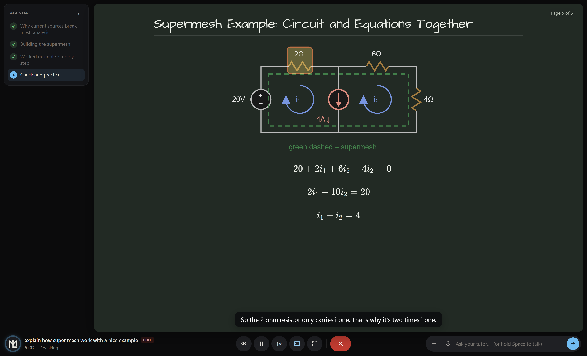
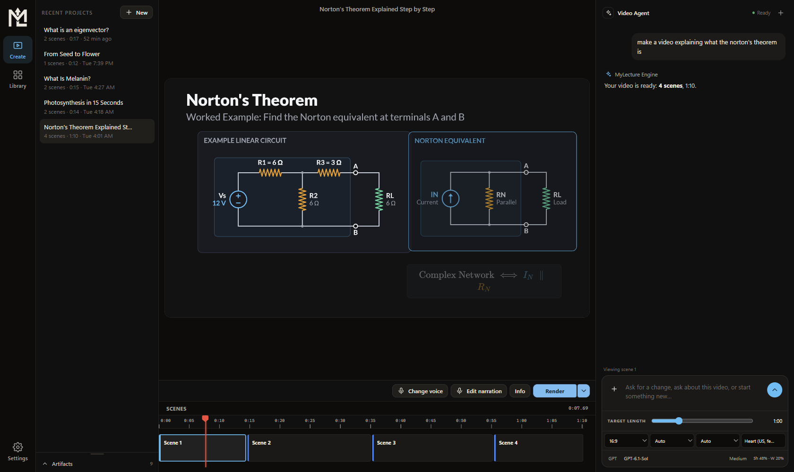

# MyLecture

**Bring every lesson to life.**

Learn anything one-on-one with a live AI tutor at a whiteboard, or turn complex ideas into narrated, animated videos. MyLecture gives students, teachers, tutors, and educational creators a Windows and macOS app for learning and explaining anything, from mathematics and science to engineering, economics, and beyond.

**[Download for Windows](https://mylecture-server.touhid3-1416.workers.dev/download/windows)** | **[Install on Mac](#install-on-mac)** | [MyLecture.ai](https://www.mylecture.ai) | [Latest release](https://github.com/touhid314/mylecture/releases/latest)



*Study: ask a question and your tutor teaches it live, talking you through it while it draws on the board.*

## New in 2.0: Study, a live tutor at your whiteboard

Type or say what you want to learn, and a tutor teaches it to you on a live call. It speaks, writes and draws on a whiteboard or blackboard as it goes, and you can interrupt at any time.

- **Talks and draws at the same time:** equations step by step, graphs, tables, code, diagrams, animated scenes and real pictures appear as the tutor talks about them.
- **Points at what it means:** "this term", "this resistor", "the blue curve": the exact part lights up on the board while it speaks.
- **Teaches like a real tutor:** a lesson agenda, questions and guided practice problems with instant feedback, and graphs with sliders to explore. It adapts to your answers.
- **Ask anything, any time:** hold **Space** to talk or type a question. Speech is recognized on your computer.
- **Bring your material:** paste a screenshot, drop a PDF or attach your notes, and the tutor teaches from them.
- **Your board, your pace:** whiteboard or blackboard (matches your theme by default), pause and rewind, captions, full screen, and every lesson saved to return to.
- **Use your own AI:** pick the tutor's model separately from Create, with its remaining usage shown on the start screen.

## Create: narrated, animated videos



*Preview the lesson, navigate its scenes, and refine it with AI, all in one workspace.*

## How it works: an optimized HTML video contract

MyLecture's [HTML video contract](electron/lecturegen/resources/contracts/html-input-contract.md) is designed for efficient AI generation. It gives the AI direct creative control over HTML, CSS, JavaScript, SVG, and Canvas, while MyLecture handles narration, timing, playback, and export. The AI defines:

- **Metadata:** the video's title, aspect ratio, and contract version.
- **A segment plan:** narration text and audio references, or timed visual-only segments.
- **A render function:** `renderSection(segment, localTime, globalTime)` draws the scene at a specific moment.

Visual state comes from the supplied time, so the player can **play, pause, or seek directly to any point** without replaying earlier animation. MyLecture generates narration and uses its actual audio duration to build the timeline. Export drives the same HTML renderer at fixed timestamps, then combines the captured frames and audio into an MP4 with FFmpeg.

### Why MyLecture is better suited to AI-generated lessons

**The AI should spend its effort creating the lesson.** MyLecture optimizes the authoring contract around the explanation, visual composition, and animation, keeping framework scaffolding out of the generated scenes.

| Authoring approach | What the AI works with |
| --- | --- |
| **MyLecture** | Direct HTML/CSS/JavaScript, a narration plan, and a time-based render function |
| Remotion | React components, composition metadata, and frame-based APIs |
| HyperFrames | HTML composition schemas and animation-runtime conventions |

MyLecture requires no React component tree, JSX build step, or third-party animation timeline in a generated scene. Its consistent contract lets the AI focus more on teaching, diagrams, pacing, and creative generation. **The result is a workflow purpose-built for AI-authored educational video, with play, pause, seek, and render support handled by MyLecture.**

## Built for teaching and learning

Make a quick concept explainer, a worked example, a revision video, or a complete lesson. Start with a topic, or attach notes, PDFs, and images to give the AI context.

- **Create and refine:** describe your lesson, then ask the AI to simplify an explanation, change a visual, or add a scene.
- **See the whole story:** preview synchronized animation and narration, scrub the scene timeline, and return to saved projects.
- **Make it sound right:** edit narration and change the voice after generation. Choose **Kokoro** for fast, natural speech or **OmniVoice** for high-quality, expressive speech.
- **Share anywhere:** export MP4 in landscape, portrait, or square at 1080p or 720p, with optional captions. Completed videos appear in the Library.
- **Choose your AI:** connect GPT, Claude, or Gemini through the supported CLI integrations, or use a supported API provider.

## Get started

1. **Windows:** [download the installer](https://mylecture-server.touhid3-1416.workers.dev/download/windows) and select the AI engines and voices you want during setup. **Mac:** see [Install on Mac](#install-on-mac).
2. Open MyLecture and connect your AI account or API key.
3. Open **Study** and ask your tutor anything, or open **Create**, describe a lesson, preview and refine it, then **Render** your video.

Windows 10/11, 64-bit, or macOS on Apple silicon or Intel. AI generation requires a supported provider account or API key; provider charges and usage limits apply. Voice models download separately, and narration synthesis, speech recognition and video rendering run locally. Study's hold-to-talk asks for microphone access the first time you use it. OmniVoice is optional and can be downloaded inside the app.

## Install on Mac

Open **Terminal**, paste this command and press **Return**:

```bash
curl -fsSL https://raw.githubusercontent.com/touhid314/mylecture/main/scripts/install-mac.command | bash
```

The installer picks the build for your Mac (Apple silicon or Intel), downloads it from the [latest release](https://github.com/touhid314/mylecture/releases/latest), installs **MyLecture** into **Applications** and opens it. Run the same command again to update.

> **How to open Terminal:** press **Command (⌘) + Space**, type **Terminal** and press **Return**. Or open **Finder → Applications → Utilities → Terminal**.

**Why a command instead of a download?** MyLecture is free and open source, so it is not notarized by Apple (notarization requires a paid Apple Developer account). macOS blocks apps downloaded in a browser that are not notarized. Installing with the command above avoids that warning; the [installer script](scripts/install-mac.command) is short and readable.

Prefer to install by hand? Download `MyLecture-<version>-mac-arm64.dmg` (Apple silicon) or `-mac-x64.dmg` (Intel) from the [latest release](https://github.com/touhid314/mylecture/releases/latest), drag MyLecture into Applications, then run `xattr -cr /Applications/MyLecture.app` in Terminal once (or use **System Settings → Privacy & Security → Open Anyway**).

## The MyLecture learning community

[MyLecture.ai](https://www.mylecture.ai) brings together video classes, interactive learning, and practice. The desktop app puts educational video creation in your hands.

Follow lessons, ideas, and updates: [YouTube](https://www.youtube.com/@mylecture.ai.2026) | [Facebook](https://www.facebook.com/mylectureai) | [Instagram](https://www.instagram.com/mylecture.ai) | [TikTok](https://www.tiktok.com/@mylectureai)

For mathematics: [MyLectureMath on Facebook](https://www.facebook.com/mylecturemath) | [MyLecture Math on Instagram](https://www.instagram.com/mylectureai.math/)

## Use your AI subscription

Connect the provider in the welcome screen or Settings, then sign in through its browser/terminal flow:

| Provider | Uses your account through |
| --- | --- |
| **GPT** | Codex CLI and your eligible ChatGPT plan |
| **Gemini** | Antigravity CLI and your Google account; Google AI Pro/Ultra offer higher limits |
| **Claude** | Claude Code and an eligible Claude subscription, such as Pro or Max |

Subscription sign-in does not require an API key. Your provider's allowances and account policies still apply. **Use with API key** is a separate option with API/provider billing.

## Run without the installer

Install Git and Node.js 22.15+ (22.x or 24.x), then run:

```sh
git clone https://github.com/touhid314/mylecture.git
cd mylecture
npm ci
npm start
```

In the app, install your chosen AI engine and voice from Settings, then connect your account. No MyLecture installer or repository `.env` file is required.

See [source setup and account sign-in](docs/GETTING_STARTED.md) for details. Developers can run `npm test` to validate changes; the [release guide](docs/RELEASING.md) covers Windows builds and publishing.

**License:** [CC BY-NC 4.0](LICENSE): free to use, share, and adapt with attribution for non-commercial purposes. For commercial use, contact [support@mylecture.ai](mailto:support@mylecture.ai).
