# LectureGen Workflow

This document describes how the static lesson-generation pipeline is wired,
from a CLI or IDE request to video scenes, an interactive segment, a practice
game, or any selected combination of those outputs.

LectureGen creates browser-authored lecture scenes. It does not render the
final MP4 itself. The generated HTML files are later resolved and rendered by
the repository's build-plan and render-video pipelines.

## End-to-End Flow

```mermaid
flowchart TD
    U[User learning request] --> ENTRY{Entry point}
    ENTRY -->|IDE| IDE["POST /lecturegen/generate"]
    ENTRY -->|CLI| CLI["src/lecturegen.ts CLI"]

    IDE --> WS[Use IDE-created unique generation workspace]
    CLI --> NEWWS[Create unique generation workspace]
    NEWWS --> WS

    WS --> PARSE[Parse request and generation settings]
    PARSE --> INPUTS["Request + output flags + aspect ratio + length<br/>theme + teaching style + attachments + getimg flag"]
    INPUTS --> VIDEO{Video selected?}

    VIDEO -->|Yes| ANSWER[Answer Generator LLM]
    ANSWER --> ANSWERFILE["Write answer.md"]

    ANSWERFILE --> SCRIPT[Script Writer LLM]
    SCRIPT --> POLICY{getimg enabled?}
    POLICY -->|No| STRIP[Strip getimg directives]
    POLICY -->|Yes| SCRIPTFILE["Write script.md"]
    STRIP --> SCRIPTFILE

    SCRIPTFILE --> BASEMAP["Copy assets/world-basemap.svg<br/>Natural Earth basemap"]
    BASEMAP --> FORK["Start selected work in parallel"]
    FORK --> FETCH{getimg enabled?}
    FETCH -->|Yes| ASSETS["Asset Fetcher<br/>download getimg assets"]
    FETCH -->|No| TRIM
    ASSETS --> TRIM["Script Trimmer<br/>split on complete N: narration beats"]
    FORK -->|If selected| IAGEN["IAGen LLM"]
    FORK -->|If selected| GAMEGEN["GameGen LLM"]

    TRIM --> BLOCKS["Sequential narration blocks<br/>min = ceil(max / 2)"]

    BLOCKS --> LOOP{For each block}
    LOOP --> ANIMATE["Animator LLM<br/>one retained session"]
    ANIMATE --> ONEHTML["Return one complete HTML file"]
    ONEHTML --> VALIDATE[HTML validator hook]

    VALIDATE -->|Pass| KEEP["Keep validated index*.html<br/>and add it to previous HTML context"]
    VALIDATE -->|Fail| REPAIR["Animator receives validator output<br/>and current line-numbered HTML"]
    REPAIR --> EDITS["Return edits-tool JSON"]
    EDITS --> APPLY[Apply range edits]
    APPLY --> VALIDATE

    KEEP --> MORE{More script blocks?}
    MORE -->|Yes| LOOP
    MORE -->|No| JOIN["Join selected parallel generation"]
    IAGEN --> JOIN
    GAMEGEN --> JOIN
    VIDEO -->|No| DIRECT["Use request directly<br/>skip video-only stages"]
    DIRECT -->|If selected| IAGEN
    DIRECT -->|If selected| GAMEGEN
    DIRECT --> JOIN
    JOIN --> WRITEEXTRAS["Write interactive.html / game.html"]
    WRITEEXTRAS --> META["Write metadata.json"]

    META --> RESULT["Return workspace, entry file,<br/>all HTML files, and completion message"]
    RESULT -->|IDE| EDITMODE["Switch client phase to edit<br/>open first index file"]
    EDITMODE --> EDITOR["Later prompts use EditorAgent<br/>against the same workspace"]
```



## Entry Points

### Programmatic API

`generateLecture(options)` in `lecturegen.ts` is the main programmatic entry
point. The IDE calls it with an already-created generation workspace. Other
callers may instead pass a parent workspace and let LectureGen create a
unique child directory.

Important inputs include:

- `request`
- `model` (default/fallback; editor and unset stages)
- optional `scriptModel` / `animatorModel` (or env `SCRIPT_MODEL` / `ANIMATOR_MODEL`)
- `workspaceDir` or `parentWorkspace`
- `generationLength`
- `aspectRatio`
- `theme`
- `teachingStyle`
- `attachments`
- `enableGetimg`
- `includeVideo`
- `includeInteractive`
- `includeGame`
- optional cancellation signal, token-tracker session ID, and log callback

CLI also supports `--script-compare a,b` for script-only A/B (shared answer from the first model; no animator).

The returned result contains:

- the generation ID
- the absolute workspace directory
- the first generated HTML file as `entryFile`
- all generated HTML paths
- video-only `index*.html` paths
- optional `interactive.html` and `game.html` paths
- a short completion message

### CLI

Running `src/lecturegen.ts` directly activates the CLI control in the same
module. It parses CLI options, creates a unique generation directory beneath
`--workspace`, then calls the same `generateLecture()` API used by other callers.

Example:

```powershell
npm run lecturegen -- --workspace "D:\mylecture\video-generations" --length 1:30 --aspect-ratio 16:9 "Explain binary search"
```

Use `--no-getimg` to prevent the script writer from requesting general images
(getimg). A bundled Natural Earth world basemap (`assets/world-basemap.svg`) is
still copied into every video workspace.

Use `--interactive` and/or `--game` to add those outputs. Use `--no-video` to
create only the selected standalone experience:

```powershell
npm run lecturegen -- --workspace ".\gens" --no-video --interactive --game "Teach vector addition"
```

### IDE

The viewer sends the first chat request to:

```text
POST /lecturegen/generate
```

The IDE server:

1. Creates a unique folder under the configured `agent.generationDir`.
2. Parses the visible request, the three output checkboxes, and hidden
   generation controls.
3. Initializes the Image download checkbox from `agent.enableGetimgTool` in
   `config.yaml`, then uses the checkbox value submitted with the request.
4. Calls `generateLecture()` with that exact folder as `workspaceDir`.
5. Streams LectureGen logs to the IDE.
6. Opens the returned entry HTML after successful generation.
7. Changes that client from `generate` phase to `edit` phase.

The initial Image download checkbox state comes from:

```yaml
agent:
  enableGetimgTool: true
```

Set it to `false` for an unchecked default or `true` for a checked default.
Before sending a generation request, the user can override that default with
the visible Image download checkbox. When unchecked, LectureGen tells the
script writer not to use getimg, strips remaining getimg requests, and still
copies the bundled Natural Earth basemap into the workspace.

Later chat messages go to:

```text
POST /agent-chat
```

Those requests create an `EditorAgent` using the same generation workspace.
The editor may read the generated material, but its mutation boundary permits
edits only to workspace-root `index.html` or `indexN.html` files.

## Request Parsing

`parseLectureGenRequest()` separates the user's actual request from the hidden
settings appended by the IDE or API wrapper:

```text
if the user query is for lecture generation then follow this:
aspect ratio: 16:9
generation length: 1:00
getimg enabled: yes
output video: yes
output interactive: no
output practice game: no
theme: ...
teaching style: ...
```

Explicit attachment directives are extracted by `prompt_builder.ts`:

```text
[(attachment: D:\absolute\path\to\image.png)]
```

When the API receives attachments outside the generation directory, it copies
them into the generation's `uploads/` folder. LLM providers receive supported
binary attachments separately from the text prompt.

If no theme or teaching style is supplied, LectureGen loads the default
resources from `.agents/`.

At least one output flag must be enabled. Video defaults to enabled for API and
CLI compatibility; interactive and game default to disabled.

## Pipeline Stages

### 1. Answer Generator

`answer_generator.ts` uses `prompts/ansgen_system.md`.

It receives the video request, requested generation length, teaching style, and
attachments. Its plain-text response is written immediately to:

```text
answer.md
```

Writing the intermediate result to disk makes a partially completed generation
inspectable if a later stage fails.

### 2. Script Writer

`script_writer.ts` uses `prompts/scriptgen_system.md`.

It receives:

- the original request
- the generated answer
- generation length
- theme and teaching style
- attachment context
- whether image requests are allowed

The output is an audiovisual script built from narration and associated visual
instructions. Narration lines use `N:` markers, which the script trimmer uses as
atomic beats.

The final script is written to:

```text
script.md
```

### 3. Asset Fetcher

`asset_fetcher.ts` contains the complete image-request parsing and image-fetching
implementation.

When getimg is enabled, it:

1. Collects image requests and destination paths from the script.
2. Fetches or generates the requested images.
3. Saves them inside the generation workspace.
4. Produces a text description of the available assets for the animator.

Uploaded user images are also included in the animator's asset description.

When getimg is disabled:

- the script writer is told not to use getimg;
- any remaining getimg requests are stripped from the returned script; and
- the bundled `assets/world-basemap.svg` is still copied for geographic maps.

### 4. Script Trimmer

`script_trimmer.ts` divides the full script into small animator inputs without
splitting an `N:` narration beat from its associated visuals and scene data.
Only narration words count toward the limit; visual instruction words do not.

The required environment variable:

```env
SCRIPT_TRIMMER_CHUNK_SIZE=75
```

sets the maximum narration words per block. The minimum is calculated as:

```text
ceil(SCRIPT_TRIMMER_CHUNK_SIZE / 2)
```

For a maximum of `75`, the normal minimum is therefore `38`. The trimmer chooses
a partition of complete narration beats that keeps blocks within those bounds
when possible. If the entire script is shorter than the minimum, it remains one
block because the trimmer never invents narration.

### 5. Animator

`animator.ts` combines:

- `prompts/animator_system.md`
- the canonical HTML input contract

One `AnimatorSession` is retained for the complete generation. Every block is
sent sequentially through that same session, allowing later calls to retain
conversation context and benefit from provider prompt caching.

For each block, the animator receives:

- original video request
- aspect ratio and full requested length
- current block number and total block count
- current trimmed script block
- theme and teaching style
- available asset descriptions
- attachments
- a summary of previously validated HTML files

The animator returns exactly one complete raw HTML document per call:

```text
one block  -> index.html
many blocks -> index1.html, index2.html, ...
```

After a file passes validation, its complete generation and repair history
remains in the retained animator conversation. It is also added to the
`previousHtmls` list before the next block is generated, preserving visual and
narrative continuity.

## Validation and Repair Loop

Every animator result is purified, written to its target file, and passed to
`validate_index_html_contract()`.

If validation passes, the workflow continues to the next block.

If validation fails, the same animator session receives:

- the validator output
- the current HTML with line numbers
- the current script block
- previous validated-file context
- the required edits-tool JSON format

The animator must return only:

```json
{
  "path": "index2.html",
  "edits": [
    {
      "lines": [12, 14],
      "new": "replacement text"
    }
  ]
}
```

The workflow applies those range edits and validates the file again. By default,
it allows at most five animator repair requests. Generation fails with the final
validator output if the file still does not pass.

When failures are layout-only, the workflow escalates to a full HTML layout
rewrite earlier than the final attempt: immediately on the first repair when
six or more layout errors are reported, or after one JSON-edit pass when three
or more layout errors remain. A layout rewrite is still always attempted on the
last repair slot. After a rewrite, remaining few layout errors are handled with
JSON edits again.

The validator includes runtime sampling at segment start/end and (when budget
permits) settled-tail local times within each segment, so failures that appear
only after an animation progresses can be detected before render.

### 6. IAGen

`iagen.ts` uses `prompts/iagen_system.md`. It receives the user request, aspect
ratio, attachments, and optional script reference. Its response is plain HTML
code written to `interactive.html`. This file has no MyLecture contract and no
required global functions.

When video and interactive output are both selected, IAGen starts immediately
after `script.md` is written and runs concurrently with asset preparation and
the animator loop.

### 7. GameGen

`gamegen.ts` uses `prompts/gamegen_system.md` with the same request and
reference-material rules. It writes the returned HTML code to `game.html`.
This file has no MyLecture contract or required global functions; the design
prompt still requests a mission overlay, replay behavior, and a score capped
at 100.

When video and game output are both selected, GameGen starts immediately after
`script.md` is written and runs concurrently with asset preparation and the
animator loop. If IAGen is also selected, all three generation branches run
concurrently. LectureGen joins the selected branches before writing metadata
and returning success.

When video output is disabled, stages 1 through 5 are skipped and these makers
work directly from the request and attachments.

## Workspace Output

A completed generation normally looks like:

```text
<generation-id>/
  answer.md
  script.md
  metadata.json
  index.html
  interactive.html
  game.html
  uploads/
  assets/
```

For multi-block scripts:

```text
<generation-id>/
  answer.md
  script.md
  metadata.json
  index1.html
  index2.html
  index3.html
  uploads/
  assets/
```

The precise asset subdirectories depend on the paths requested by the script.

`metadata.json` contains a title derived from the request and a short lecture
description.

## Module Map

| Module | Responsibility |
| --- | --- |
| `lecturegen.ts` | Main orchestration, API, CLI, workspace creation, attachment copying, and final result |
| `answer_generator.ts` | Generates the educational answer |
| `script_writer.ts` | Converts the answer into an audiovisual script |
| `asset_fetcher.ts` | Parses, downloads, or generates requested image assets |
| `script_trimmer.ts` | Partitions complete narration beats into bounded blocks |
| `animator.ts` | Maintains the sequential animator session and validation/repair loop |
| `iagen.ts` | Produces the standalone interactive experience |
| `gamegen.ts` | Produces the standalone practice game |
| `lecturegen_shared.ts` | Shared LLM session, prompt-loading, attachment, and filename helpers |
| `prompt_builder.ts` | Inlines prompt resources and extracts attachment directives |
| `utils/html_contract.ts` | Purifies and validates generated lecture HTML |
| `utils/file_edits.ts` | Applies animator repair edits |
| `editor-agent/` | Handles post-generation user edit requests against the same workspace |

## Failure and Cancellation Behavior

- The static `LectureGen` session accepts only one generation request.
- A second request requires a new LectureGen session or IDE New Chat.
- Missing `SCRIPT_TRIMMER_CHUNK_SIZE` is an error when video is selected; it is
  not read on interactive/game-only runs.
- Missing required request/model values fail before generation.
- A cancellation signal stops between pipeline stages and animator blocks.
- Asset failures, invalid animator/interactive/game output, and exhausted
  validator repairs stop the workflow with an error.
- The IDE changes to edit mode only after `generateLecture()` succeeds.
